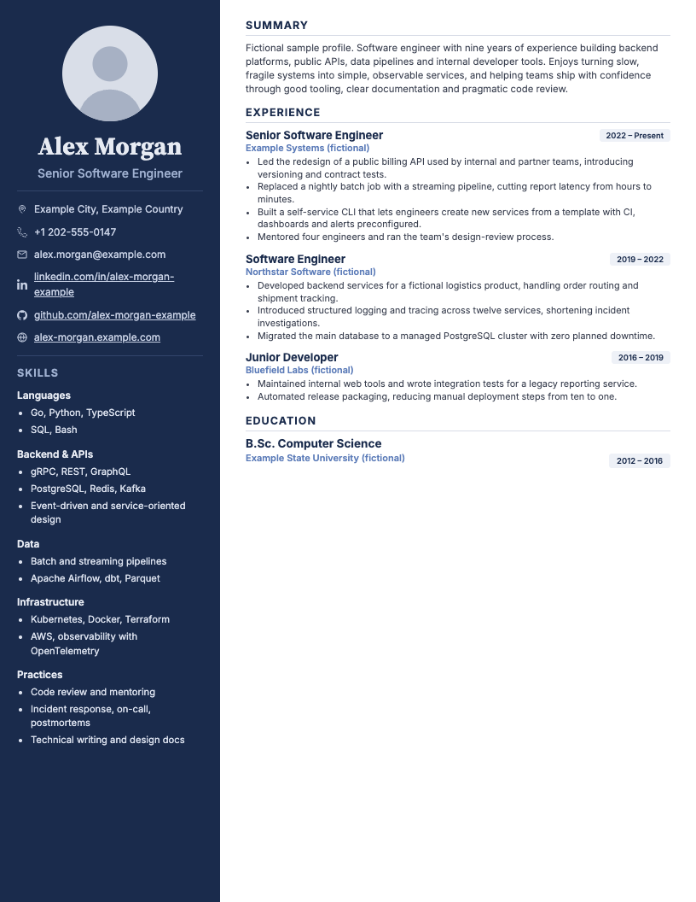
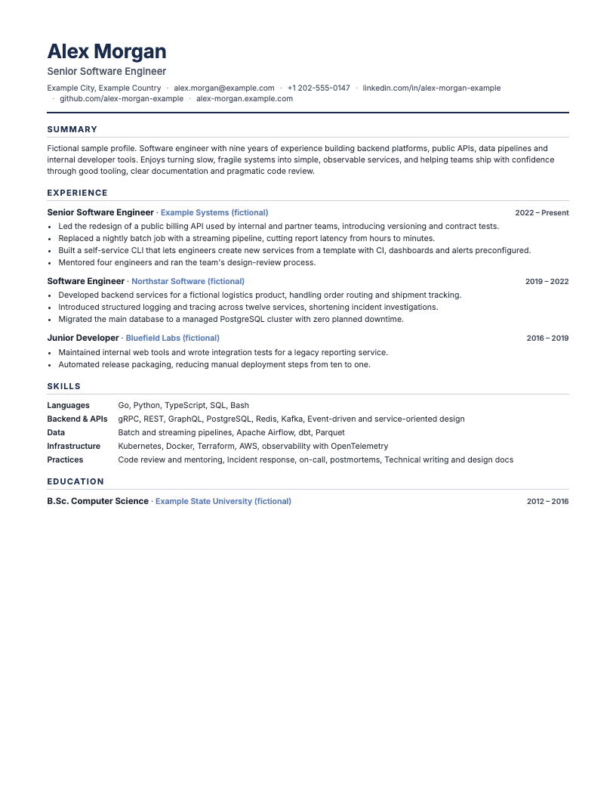

# Resume PDF Builder

[](https://github.com/shivamsingh262/resume-pdf-builder/actions/workflows/ci.yml)
[](LICENSE)
[](https://nodejs.org/)
[](https://pptr.dev/)

Write your resume as a JSON file and get a clean, print-ready PDF. Layout and
styling live in HTML/CSS themes, and the PDF is printed by headless Chromium
through [Puppeteer](https://pptr.dev/).

```sh
npm install
cp resume.example.json resume.json   # then edit resume.json
npm run build                        # -> output/resume.pdf
```

It's for developers who would rather keep their resume in version-controlled
data than in a word processor, and who want the same output every time.

<p align="center">
  
  &nbsp;
  
</p>

The sample above is generated from the fictional
[`resume.example.json`](resume.example.json); see
[`docs/example-resume.pdf`](docs/example-resume.pdf) for the PDF.

## Features

- **Plain JSON input** with strict validation. Errors name the exact field,
  e.g. `experience[1].bullets[0]: must be a string (got number)`.
- **Two themes**: the default two-column `sidebar` design and a single-column
  `minimal` layout. Both take a custom accent color.
- **Multi-page output**: long resumes flow onto more pages without clipping.
  Short jobs, headings and bullets are kept from splitting awkwardly, and
  a resume that fits on one page stays exactly one page.
- **US Letter or A4.**
- **Self-contained output**: fonts and photo are embedded in the HTML and PDF.
  Text in the PDF is selectable and searchable.
- **Safe with untrusted content**: all text is HTML-escaped, links must be
  `https://`, scripts and network access are disabled while rendering, and
  photo paths can't leave the config's directory.
- **Offline** once dependencies are installed.

## Requirements

- **Node.js 22.13 or newer** (`.nvmrc` pins 22; Node 24 also works). With nvm,
  run `nvm use`.
- Several hundred MB of disk space (about 600 MB on macOS) for the Chromium builds that Puppeteer downloads
  during `npm install` (stored in `~/.cache/puppeteer`).

## Usage

```sh
npm run build                       # build resume.json
npm run build:example               # build the fictional example
node build-pdf.js --help            # all options
```

| Option | Default | Description |
| --- | --- | --- |
| `-c, --config <file>` | `resume.json` | Resume JSON file |
| `-t, --theme <name>` | `sidebar` | `sidebar` or `minimal` (`default` is an alias for the default theme) |
| `--color <hex>` | theme default (`#1A2B4C`) | Accent color, `#RGB` or `#RRGGBB` |
| `--page-size <size>` | `letter` | `letter` (8.5 × 11 in) or `a4` (210 × 297 mm) |
| `-o, --out-dir <dir>` | `output` | Output directory, relative to the current directory |
| `--name <name>` | config file name | Output file name without extension |
| `--html-only` | | Write only the HTML file, don't launch Chromium |
| `--list-themes` | | List the available themes |

Examples:

```sh
node build-pdf.js --theme minimal --color "#0F5257"
node build-pdf.js --config cv/jane.json --page-size a4 --out-dir dist --name jane-doe
```

Each build writes two files, overwriting earlier ones:

- `output/<name>.html` is a standalone HTML file you can open in a browser to
  preview. The browser shows it as one continuous page; page breaks only
  appear in the PDF.
- `output/<name>.pdf` is the final PDF. The command prints the page count.

Pass `npm run build -- <options>` to forward options through npm.

## Configuration

`resume.json` must be strict JSON: no comments, no trailing commas. Unknown
fields are rejected, which catches typos such as `"sumary"`.

```json
{
  "name": "Alex Morgan",
  "title": "Senior Software Engineer",
  "location": "Example City, Example Country",
  "email": "alex.morgan@example.com",
  "phone": "+1 202-555-0147",
  "linkedin": "https://www.linkedin.com/in/alex-morgan-example",
  "github": "https://github.com/alex-morgan-example",
  "website": "https://alex-morgan.example.com",
  "photo": "assets/placeholder-avatar.svg",
  "summary": "One or more paragraphs. Use \n\n for a blank line.",
  "skills": [{ "category": "Languages", "items": ["Go, Python", "SQL"] }],
  "experience": [
    {
      "title": "Senior Software Engineer",
      "company": "Example Systems",
      "dates": "2022 – Present",
      "bullets": ["Led the redesign of a public billing API."]
    }
  ],
  "education": [{ "degree": "B.Sc. Computer Science", "school": "Example State University", "dates": "2012 – 2016" }],
  "theme": { "name": "sidebar", "accentColor": "#1A2B4C", "pageSize": "letter" }
}
```

| Field | Type | Required | Notes |
| --- | --- | --- | --- |
| `name` | string | **yes** | Single line, max 200 characters |
| `title` | string | **yes** | Single line, e.g. your current role |
| `location` | string | no | |
| `email` | string | no | Must look like `name@domain.tld`; rendered as a `mailto:` link |
| `phone` | string | no | Digits, spaces and `+ - ( ) . /`, optional `ext. 12` |
| `linkedin` | string or object | no | `https://` URL on `linkedin.com`, or `{ "url": "...", "label": "..." }`. The default label is the URL without `https://www.` |
| `github` | string or object | no | Same format as `linkedin`, but the URL must be on `github.com` |
| `website` | string or object | no | Same format as `linkedin`, for any `https://` site, e.g. a portfolio. The default label is the host and path, e.g. `example.com` |
| `photo` | string or `null` | no | Path relative to the config file (see below) |
| `summary` | string | no | Line breaks allowed, max 5000 characters |
| `skills` | array | no | `{ "category": string, "items": [string, ...] }`; `items` needs at least one entry |
| `experience` | array | no | `{ "title", "company", "dates"?, "bullets"? }`. `title` and `company` are required; `bullets` is an array of strings (line breaks allowed) |
| `education` | array | no | `{ "degree", "school", "dates"? }`. `degree` and `school` are required |
| `theme` | object | no | `{ "name"?, "accentColor"?, "pageSize"? }`. CLI flags override these |

How empty and missing values behave:

- Omitting an optional field, or setting it to `null`, hides it. An empty
  string `""` is an error, so blanks never end up in the PDF by mistake.
- An empty or missing `skills`, `experience` or `education` array hides that
  section along with its heading. Without a `summary`, the Summary section is
  hidden too.
- Leading and trailing whitespace is trimmed. Text is never rewritten,
  shortened or filled in automatically.

### Photo

- Set `"photo"` to a `.png`, `.jpg`, `.jpeg`, `.webp` or `.svg` file **inside
  the directory that contains the config file**, e.g. `"photo": "me.jpg"` next
  to `resume.json`. Absolute paths, URLs, `..` and symlinks that lead outside
  that directory are rejected, as are files over 5 MB or files whose content
  doesn't match their extension.
- To build without a photo, set `"photo": null` or remove the field.
- The image is cropped to a circle in the `sidebar` theme. The `minimal` theme
  never shows a photo.

Keep your real `resume.json` and photo out of version control. `resume.json`
and a `private/` directory are already in `.gitignore`.

## Themes and accent colors

| Theme | Description |
| --- | --- |
| `sidebar` (default) | Two columns: a colored sidebar with photo, contact details and skills, and a main column with summary, experience and education |
| `minimal` | Single column with no photo and a compact header. Plain-text extraction gives a clean reading order, which helps applicant-tracking systems |

`--color` (or `theme.accentColor`) takes a hex color, normalized to lowercase
`#rrggbb`. Anything else, including named colors, is rejected, so arbitrary
strings never reach the CSS. The accent is used for headings on white and as
the sidebar background behind light text, so it needs a contrast ratio of at
least **4.5:1 against white**; lighter colors are rejected with the measured
ratio. In the `sidebar` theme the other colors (sidebar text, company names,
date badges) are re-tinted from the accent and adjusted to stay readable.

Adding a theme is covered in [CONTRIBUTING.md](CONTRIBUTING.md#adding-or-changing-a-theme).

## How it works

1. `src/config.js` reads the file with `JSON.parse`, and `src/validate.js`
   checks every field and returns a normalized copy.
2. `src/render.js` resolves the theme, accent color and page size, then
   calls the theme's `render()` function. That produces HTML in which every
   piece of user text is escaped. Fonts and the photo are embedded as `data:`
   URIs, and a Content-Security-Policy blocks scripts and remote loads.
3. `src/pdf.js` loads the HTML into headless Chromium with JavaScript disabled
   and all non-`data:` requests blocked, waits for the fonts, and prints it.
   The CSS `@page` size and the Puppeteer `width`/`height` come from the same
   definition in `src/page.js`, so they can't disagree.
4. Single-page check for themes that support it (`sidebar`): the original
   edge-to-edge one-page layout is printed first. If it fits on one page it's
   kept. Otherwise a multi-page variant with spacing at each page bottom is
   printed instead.

Output files are written atomically (temp file, then rename), so a failed
build never leaves a half-written PDF.

## Running the tests

```sh
npm test            # everything (launches Chromium; about 5 seconds)
npm run test:unit   # validation, config and rendering only, no browser
```

The tests use Node's built-in test runner. They cover validation, malformed
JSON, URL and photo-path safety, escaping, themes and colors, CLI behavior,
and end-to-end PDFs. The PDF tests check page counts and dimensions, look for
missing text and blank pages with [pdf.js](https://mozilla.github.io/pdf.js/),
and compare the default theme pixel by pixel against the original template in
`test/fixtures/legacy-template.js`.

`npm run previews` regenerates the images and sample PDF in `docs/`.

## Troubleshooting

- **`Could not start Chromium` / `Failed to launch the browser process`**: the
  browser download is missing or broken. Run
  `npx puppeteer browsers install chrome`, or delete `node_modules` and run
  `npm install` again with a supported Node version (check `node -v`). To use
  a Chrome that's already installed, set `PUPPETEER_EXECUTABLE_PATH`.
- **Linux: `No usable sandbox`**: on Ubuntu 23.10+ AppArmor blocks Chromium's
  sandbox. Either run
  `echo 0 | sudo tee /proc/sys/kernel/apparmor_restrict_unprivileged_userns`
  or follow the
  [Puppeteer troubleshooting guide](https://pptr.dev/troubleshooting). On
  minimal systems or containers you may also need Chromium's shared libraries.
- **`npm install` skipped the Chromium download**: this happens if
  `PUPPETEER_SKIP_DOWNLOAD` is set, or on very old Node versions. Use Node 22+
  and run `npx puppeteer browsers install chrome`.
- **Fonts look wrong**: make sure `assets/fonts/*.woff2` exist. They're
  embedded at build time. Characters outside the Latin subset (Cyrillic, CJK,
  emoji, ...) use system fallback fonts, so they can look different from one
  machine to another.
- **`... is not valid JSON (line X, column Y)`**: look for trailing commas,
  comments, single quotes or unquoted keys at that position.
- **`resume.json has N problems`**: each line names a field and what's wrong.
  The field reference is in [Configuration](#configuration).
- **`PDF generation failed`**: the HTML file is still written, so open it in a
  browser to inspect the layout. Run with `DEBUG=1` to print the underlying
  error.
- **"Some content is wider than the page"**: a value can't wrap, e.g. a very
  long date range in a badge. Shorten it.

## Known limitations

- Only two themes, and only the accent color is configurable; fonts and sizes
  change by editing a theme.
- No custom sections (projects, publications, ...) and no extra links beyond
  LinkedIn, GitHub and one website. The schema is intentionally small.
- Page breaks come from CSS fragmentation in Chromium. A job with more than 6
  bullets (or more than about 1200 characters of bullets) may be split between
  bullets, and the sidebar theme's columns paginate independently.
- The HTML preview doesn't show page breaks; use the PDF to check pagination.
- Bundled fonts cover Latin scripts only.
- Output depends on the Chromium version Puppeteer installs, so upgrading
  Puppeteer can shift rendering slightly.

## Contributing

Bug reports and pull requests are welcome. See [CONTRIBUTING.md](CONTRIBUTING.md).

## License

The code is under the [MIT License](LICENSE). The bundled Inter and Source
Serif 4 fonts are under the SIL Open Font License 1.1; see
[`assets/fonts/README.md`](assets/fonts/README.md). All names, companies and
details in the example resume are fictional.
